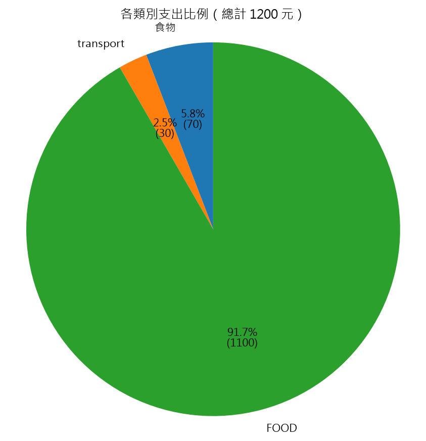

# Expense Tracker

簡單的記帳工具：輸入支出，並依類別畫出圓餅圖。

## 環境需求
- Python 3.10 以上
- matplotlib

## 使用方式

### 輸入支出
```
python expense_input.py
```
依提示輸入日期（直接按 Enter 用今天）、金額、類別、備註（可留空）。
資料會存在 `expenses.csv`，欄位為 `date, amount, category, note`。

### 產生圓餅圖
```
pip install matplotlib
python pie_chart.py
```
讀取 `expenses.csv`，依類別加總金額並畫出圓餅圖，同時存成 `pie_chart_sample.png`。

## 範例圖表


## 分工
- Member A (xyk774)：輸入模組
- Member B：視覺化模組