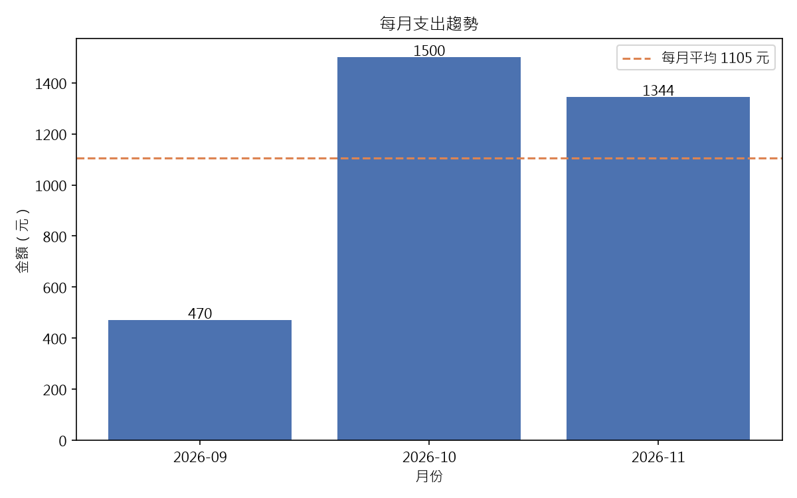

# Expense Tracker

以 Python 製作的簡易記帳工具：輸入每筆支出，並依類別畫出圓餅圖。
本專案為軟體工程導論 Assignment 1（Version Control Practice），兩人以 Git 分支協作完成。

## 功能
- **輸入支出**：記錄日期、金額、類別、備註（備註可留空）
  - 日期直接按 Enter 自動帶入今天
  - 檢查日期格式與金額，輸入錯誤會要求重新輸入
  - 可連續輸入多筆，資料自動存入 `expenses.csv`
- **圓餅圖**：依類別加總金額並畫出圓餅圖
  - 每一塊顯示百分比與金額，標題顯示總支出
  - 支援中文類別名稱
  - 自動存成 `pie_chart_sample.png`
  - 列出所有支出（含編號與總計）
  - 依編號刪除支出，刪除前會再次確認
  - **每月趨勢圖**：依月份加總支出畫成長條圖
  - 每根長條標示金額，虛線為每月平均
  - 自動存成 `trend_chart_sample.png`

## 環境需求
- Python 3.10 以上
- matplotlib

```
pip install -r requirements.txt
```

## 使用方式

### 1. 輸入支出
```
python expense_input.py
```
執行後出現選單：`1` 新增支出、`2` 列出所有支出、`3` 刪除支出、`4` 離開。

### 2. 產生圓餅圖
```
python pie_chart.py
```
讀取 `expenses.csv` 畫出圓餅圖，並存成 `pie_chart_sample.png`。

### 3. 產生每月趨勢圖
```
python trend_chart.py
```
讀取 `expenses.csv`，依月份畫出支出長條圖，並存成 `trend_chart_sample.png`。

## 範例圖表



## 資料格式
`expenses.csv` 的欄位：

| 欄位 | 說明 | 範例 |
|---|---|---|
| date | 日期（YYYY-MM-DD） | 2026-11-25 |
| amount | 金額 | 70 |
| category | 類別 | food |
| note | 備註（可空白） | 午餐 |

## 專案結構
```
expense-tracker/
├── expense_input.py      # 輸入模組（Member A）
├── pie_chart.py          # 視覺化模組（Member B）
├── expenses.csv          # 支出資料
├── pie_chart_sample.png  # 圓餅圖範例
├── trend_chart.py        # 每月趨勢圖
├── trend_chart_sample.png
├── requirements.txt      # 需要的套件
└── README.md
```

## 分工
| 成員 | GitHub | 負責 |
|---|---|---|
| Member A | [xyk774](https://github.com/xyk774) | 輸入模組、README、分支合併 |
| Member B | [weiwei0115](https://github.com/weiwei0115) | 視覺化模組（圓餅圖） |

## Git 協作流程
每位成員在自己的分支上開發，完成後在指令列以 `git merge --no-ff` 合併回 `main`，保留每條分支的合併紀錄。

| 分支 | 負責人 | 內容 |
|---|---|---|
| `feature-input` | A | 支出輸入模組 |
| `feature-piechart` | B | 圓餅圖視覺化模組 |
| `docs-readme` | A | README 使用說明與範例圖 |
| `docs-improve` | A | requirements.txt、.gitignore、完整 README |
| `feature-delete` | A | 列出與刪除支出 |
| `feature-trend` | A | 每月支出趨勢圖 |

```
git checkout main
git merge --no-ff feature-input
git merge --no-ff origin/feature-piechart
```